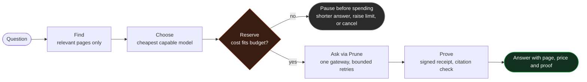
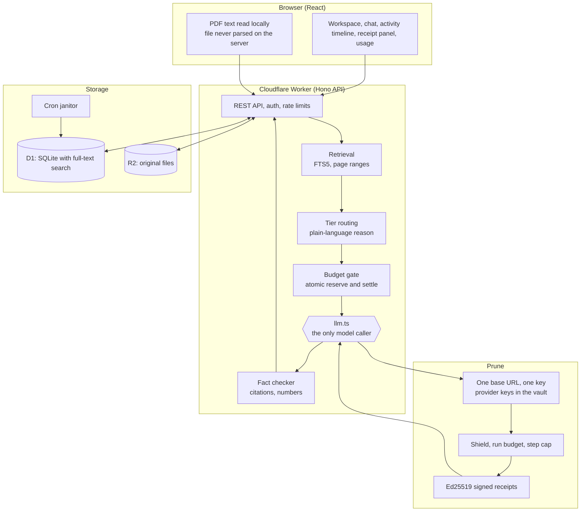
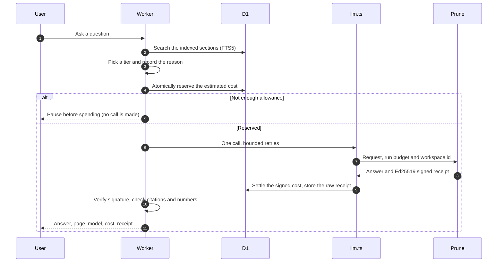

# Athena

Document question answering that reports the cost of every answer, with a signed receipt as proof.


[Problem](#problem) | [Solution](#solution) | [Differentiators](#what-makes-athena-different) | [Results](#measured-results) | [Architecture](#architecture) | [Quick start](#quick-start) | [Status](#project-status)

---

## Overview

Most AI applications cannot say what an individual answer cost. Neither the user, the finance team, nor usually the developer who built the application knows. Athena reports the cost of every answer, and backs it with a signed Prune receipt.

## Problem

AI over documents fails in four costly ways.

| Issue | Detail |
|---|---|
| Cost grows with every question | Most tools resend the whole document and the whole chat on every question. On our benchmark the naive approach sends 10,639 prompt tokens per question, and the figure keeps growing with each follow-up. |
| Cost is invisible | The answer carries no price and no model name. The cost is discovered when the invoice arrives. |
| Failures cost money | A timeout triggers a blind retry, and a crash can bill the user twice for work already paid for. |
| Trust is weak | PDFs can hide instructions, provider keys end up in code, and nobody can prove what was spent. |

## Solution

Athena reads a document once, sends only the parts that matter, selects the cheapest model that can do the job, checks the budget before every call, and proves the cost of every answer with a signed Prune receipt.

Every question runs through five steps, shown live in the application as an activity timeline.



### Contents of each answer

```text
+----------------------------------------------------------------------+
|  The customer must pay each invoice within 45 days of the invoice    |
|  date. [p.5]                                                         |
+----------------------------------------------------------------------+
|  Economy | Why this model: short lookup | Citation check passed      |
|  Prune receipt | Ed25519 signed                  [ Verify receipt ]  |
|                                                                      |
|  How this cost was calculated                                        |
|    2,102 tokens in  x price per 1M  =  input cost                    |
|       59 tokens out x price per 1M  =  output cost                   |
|    Calculated total | Charged | matches                              |
+----------------------------------------------------------------------+
```

The layout above is illustrative of the answer card and receipt panel.

---

## What makes Athena different

| Capability | Why it matters |
|---|---|
| Money is a limit, not a report | Cost is reserved atomically before the call. If it cannot be afforded, nothing is sent. A crash or a race cannot overspend. |
| A Prune receipt on every answer | Each call is Ed25519-signed by Prune. Athena stores the receipt byte for byte, verifies it locally and with Prune's hosted check, and exports it for independent verification. |
| Click-to-verify cost | Every answer shows its cost and how it was derived. Verify rechecks it on the server. |
| Cost per good answer | Retries, escalations and failures are counted, then divided by the answers that pass the citation check. |
| Deterministic fact checker | Code checks that every cited page was in the text sent and that every number appears on that page. No second model, no extra cost. |
| Designed failure handling | Retries are bounded. There is no retry on bad keys, empty budgets, Prune Shield blocks or uncertain billing. Finished work is saved, and the application pauses with options. |
| Prune does real work | One base URL, provider keys in the Prune vault, server-side run budgets and step caps, Shield, per-workspace cost attribution, and signed receipts as the source of truth for cost. |

---

## Measured results

All figures below come from our own runs. Nothing is projected.

### Head-to-head

Same 20-page contract, same 8 questions, live model calls.

| | Whole document to strongest model | Athena |
|---|:-:|:-:|
| Prompt tokens | 36,208 | 14,106 (-61%) |
| Cost | $0.0057 | $0.0034 (-40%) |
| Correct | 8 / 8 | 7 / 8 |

Athena missed one question by taking a decoy clause from another page. We report it rather than omit it.

### Where the naive approach breaks

40-page contract, 8 back-to-back questions.

| | Result |
|---|:-:|
| Naive approach | Rejected as too large (8,823 tokens against an 8,000 per minute limit) |
| Athena | 8 / 8 correct |
| Right page cited | 8 / 8 |
| Cost per answer | about $0.0005 |

### Other measurements

| Metric | Result | Source |
|---|---|---|
| Prompt size per question | 2,134 tokens against 10,639 naive (80% smaller) | Benchmark: two 30-page agreements, 20 questions |
| Fact checker: good answers passed | 24 / 25 (96%) | 46 hand-labelled answers, `athena/reports/gate_eval.json` |
| Fact checker: bad answers caught | 14 / 21 (67%) with zero model calls | Same set; what it misses is published |
| Real signed Prune receipt | Verified locally (Ed25519) and by Prune's hosted verifier | Phase 0, `athena/PHASE0-FINDINGS.md` |
| Automated tests | 204 passing | `npm run check` |

Token counts are exact. Dollar figures in the head-to-head use our configured tier prices.

---

## Architecture



<details>
<summary>One question, step by step (sequence)</summary>



</details>

<details>
<summary>Failure handling</summary>

| Situation | Behaviour |
|---|---|
| Timeout before sending | Retry with backoff, within a fixed attempt limit |
| Connection drops after sending | Charge the estimate, mark billing uncertain, never retry blindly |
| Rate limit (429) | Wait the full time requested; if it does not fit, stop and report how long |
| Bad key, empty budget, Prune Shield block | Stop at once: no retry, nothing charged |
| Two requests race for the last cents | Atomic reservation: one proceeds, one pauses |
| Duplicate submission | Refused by idempotency key before anything is sent |
| Hidden instructions in a PDF | Document text fenced as data; output scanned for secrets and foreign links |
| Kill switch on | Every call refused before anything is reserved |

</details>

---

## Tech stack

Prune (gateway and receipts), Cloudflare Workers, D1 (SQLite with FTS5), R2, Hono, Zod, React, Vite, pdf.js, Ed25519 signatures. TypeScript throughout.

---

## Quick start

Runs fully offline against a mock Prune that signs real Ed25519 receipts. No accounts are needed. Requires Node 24 (built-in `node:sqlite` and TypeScript type stripping).

```bash
cd athena && npm install && npm --prefix web install
npm run check            # typecheck, 204 tests, single-caller guard, web typecheck
npm run dev:stack        # API and mock Prune        (terminal 1)
npm run web              # http://127.0.0.1:5173     (terminal 2)
```

<details>
<summary>Run on the real Prune</summary>

Put your Prune key in `athena/.env` or `athena/.dev.vars` (both gitignored), never in code. Provider keys live in the Prune vault, not here.

```bash
PRUNE_API_KEY=prune_...
```

When deployed, set it as a Worker secret: `npx wrangler secret put PRUNE_API_KEY`.
A CI guard (`npm run check:caller`) fails the build if any file except `llm.ts` touches a model host, or if a key appears in code.

</details>

<details>
<summary>Verify receipts independently</summary>

Export receipts from the Usage screen, then run either verifier:

```bash
python bench/verify.py athena-receipts.jsonl
# or
node scripts/verify-receipts.mjs athena-receipts.jsonl
```

</details>

---

## Repository map

| Path | Contents |
|---|---|
| [`athena/`](athena) | The code: Cloudflare Worker backend (`src/`), React app (`web/`), mock Prune, tests and benchmark. Start at [`athena/README.md`](athena/README.md) |
| [`STATUS.md`](STATUS.md) | Project status, the four workstreams with file ownership, and the phases (read this first) |
| [`memory.md`](memory.md) | The team's agreed product scope, flow, safety controls and build order (source of truth) |
| [`athena.md`](athena.md) | Technical plan: architecture, database, API, tests, benchmark |
| [`prune.md`](prune.md) | Notes on integrating with Prune |
| [`athena-content.md`](athena-content.md) | Website and in-app copy |
| [`docs/pitch.md`](docs/pitch.md) | Pitch deck content, script and judge Q&A |
| [`CONTRIBUTING.md`](CONTRIBUTING.md) | How the team avoids merge conflicts |
| [`status/`](status) | One status file per team member |
| [`docs/archive/`](docs/archive) | Earlier plans kept for reference |

---

## Project status

| Area | Built and tested | Next |
|---|---|---|
| Documents | Text PDFs indexed once with pages, retrieval, page citations, invoice pack with total check | OCR for scanned pages; whole-document summaries |
| Models | Three tiers with plain-language reasons, one escalation on a failed check, all through Prune | Routing evaluated on a mixed task set |
| Money | Atomic reserve and settle, per-call cap, allowance, pause with options, kill switch, cost per good answer | Reconcile uncertain charges against receipts |
| Proof | Raw receipt storage, Ed25519 verify, Prune hosted fallback, click-to-verify cost, export, offline verifier | Full receipts-backed benchmark |
| Safety | Fenced document text, output scanner, injection suite, single-model-caller guard, rate limits | Cross-user isolation audit |
| Product | Landing page, workspace, chat with citations, live activity timeline, usage panel | Chat without a document; Markdown checkpoint near the limit |

Verified on live services: a real signed Prune receipt, checked locally and by Prune's hosted verifier. Not yet verified: a full receipts-backed benchmark on every arm. We claim only what we have measured.

---

Built for FORGE: Ship It Lean, AI Apps on a Budget. Powered by Prune.
